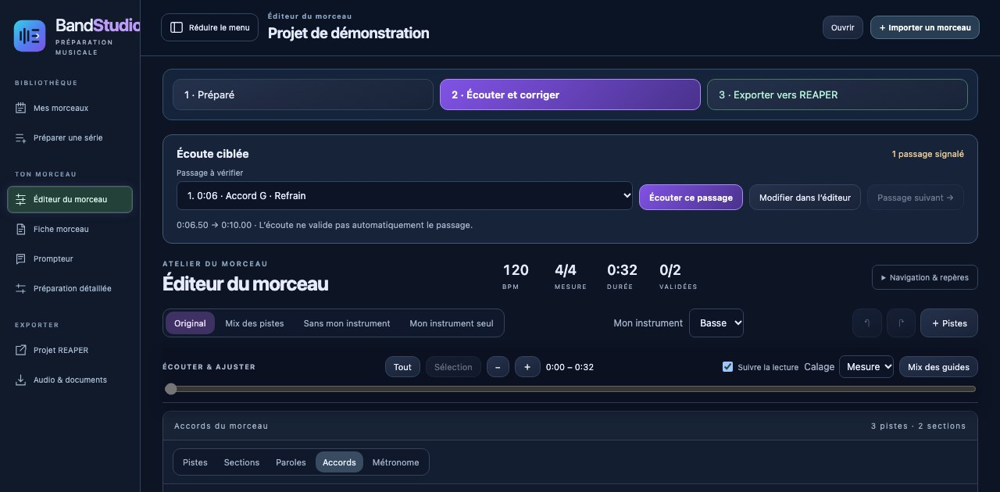

# BandStudio

**Learn your part before rehearsal.** Import a recording, solo the bass to learn the line, then mute it and play along with the band. BandStudio brings separated tracks, a metronome, lyrics and chord charts together in a local editor for Mac and Windows.

[Official website](https://herve8940.github.io/BandStudio/en.html) · [Download for Windows](https://github.com/herve8940/BandStudio/releases/latest/download/BandStudio-1.1.0-Windows-x64.zip) · [macOS setup guide in French](docs/BANDSTUDIO.md#macos) · [Français](README.md)

## Install BandStudio

| Your computer | Getting started |
| --- | --- |
| **Windows 11 x64** | Extract the entire ZIP to a writable folder, then open **BandStudio.exe**. Python and FFmpeg are included. WebView2 and .NET Framework 4.8 are required. Install optional engines in **Réglages → Analyses locales**. |
| **An existing Intel or Apple Silicon Mac installation** | Open **Réglages** and check for updates. Quit BandStudio after the download finishes, then reopen it. |
| **First-time Mac setup** | Building from source requires an existing ReaCue engine and prepared Python environments. A standalone installer for a new Mac is not currently available. [Requirements and commands](docs/BANDSTUDIO.md#macos) |

**Version 1.1.0, 24 November 2026**, opens directly in the editor and optimizes track waveform calculation. Update packages preserve your projects and settings. [Release notes in English](docs/RELEASE_2026-11-24.md#english) · [Changelog](CHANGELOG.md)

## Prepare your first song

The control names below match the labels in the app.

1. Import your audio file in **Mes morceaux**. Leave **Préparer automatiquement après l’import** selected to use the installed engines. For several files, open **Préparer une série** and start the queue.
2. In **Éditeur du morceau**, solo a track, loop a section or slow down playback. Listen to flagged passages before adjusting a marker, a lyric or a chord.
3. Open **Fiche morceau** to export a PDF with chords and lyrics by bar. In **Projet REAPER**, export the tracks and media to continue working in REAPER.

[Visual guide from import to REAPER](https://herve8940.github.io/BandStudio/tutorial.html) · [Song sheet and PDF guide](https://herve8940.github.io/BandStudio/song-sheet.html) · [Full walkthrough](docs/BANDSTUDIO_TUTORIAL_en.md)

## In rehearsal

- **Listen**. Adjust volume, pan, speed and pitch. Isolate your part or play with the other tracks. Available instruments depend on the installed model.
- **Follow the song**. Adjust tempo, section boundaries, metronome and count-in. Compare chord charts, choose a capo and align lyrics to the vocal.
- **Export**. Save a mix, individual tracks, LRC/SRT lyrics, drum MIDI, a PDF song sheet or a REAPER project. Individually exported audio tracks keep their original speed and pitch.

Audio processing runs on your computer. Lyrics, chord and artwork lookups use online services. Results depend on the recording and installed engines. [Technical guide and limitations in French](docs/BANDSTUDIO.md#traitement-du-morceau)

## Help and contributions

Ask rehearsal questions in the [BandStudio Discord](https://discord.gg/5UnQPdMUpR). To report a reproducible issue, include your operating system and the steps you followed. **Aide & Discord** lets you review diagnostic information before you share it. [Support](SUPPORT.md) · [Report an issue](https://github.com/herve8940/BandStudio/issues/new/choose)

The source code uses the [MIT license](LICENSE). Dependencies and models have their own licenses, some with non-commercial terms. [Third-party notices](THIRD_PARTY_NOTICES.md) · [Contributing and running tests](CONTRIBUTING.md) · [Security](SECURITY.md) · [Code of conduct](CODE_OF_CONDUCT.md)

For soundchecks and stage monitoring, see [BandPilot](https://herve8940.github.io/BandPilot/). The original REAPER scripts are documented in the [ReaCue manual](README_REACUE.md).
