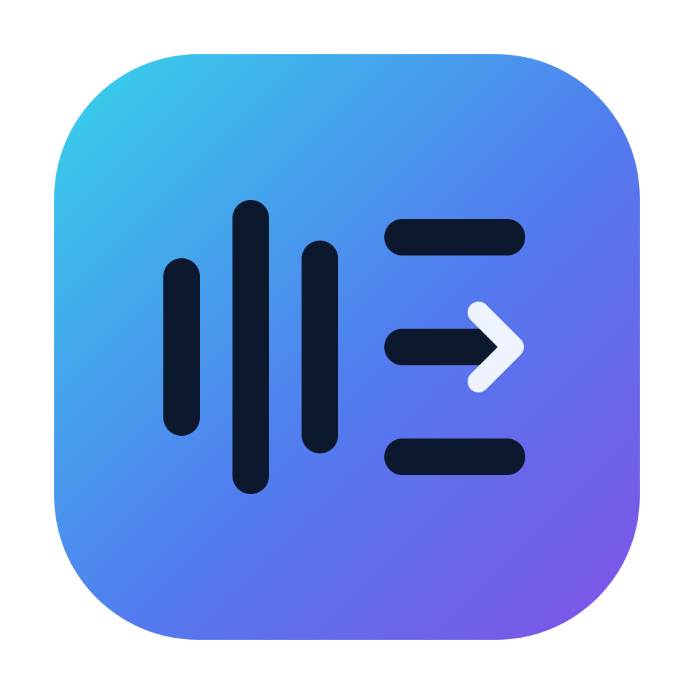
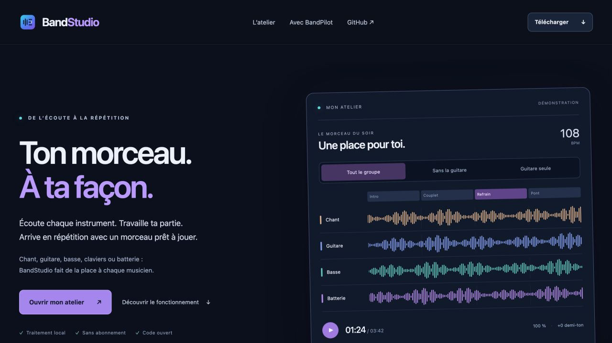

<div align="center">
  
  <h1>BandStudio</h1>
  <p><strong>Ton morceau. À ta façon.</strong><br>Un atelier local pour tous les musiciens, de l’écoute à la répétition.</p>

[Site](https://herve8940.github.io/BandStudio/) · [Télécharger](https://github.com/herve8940/BandStudio/releases/tag/bandstudio-main) · [Guide](docs/BANDSTUDIO.md) · [English](README.en.md) · [Signaler un bug](https://github.com/herve8940/BandStudio/issues/new/choose)


</div>

BandStudio transforme un fichier audio en espace de travail : sépare les instruments, prépare ta partie, puis exporte un morceau validé dans REAPER. Chant, guitare, basse, claviers et batterie disposent des mêmes commandes d’écoute. Les traitements audio tournent sur ton ordinateur.



## Ce que tu peux faire

- **Séparer et mixer** : 4 ou 6 stems, volumes, panoramiques, mute, solo, original et mix. Choisis ton instrument pour l’isoler ou jouer sans lui. Sous-pistes de batterie et chant principal/chœurs avec les moteurs facultatifs.
- **Travailler un passage** : boucles, vitesse de 50 à 150 %, transposition de ±12 demi-tons, progression du tempo et capo pour les accords affichés.
- **Comprendre le morceau** : tempo, temps et débuts de mesure, tonalité, sections modifiables, accords et paroles synchronisées. Les corrections manuelles sont conservées.
- **Organiser les morceaux** : bibliothèque en liste avec pochettes intégrées ou choisies, suppression réversible et restauration.
- **Tout préparer** : enchaîne les analyses installées et les guides, en conservant les corrections manuelles et les étapes terminées en cas d’arrêt.
- **Préparer la répétition** : click, appels de sections, décomptes, repères et notes. Validation explicite du mix, de la grille et des guides avant l’envoi dans REAPER.
- **Exporter** : mix, stems WAV/FLAC/MP3/AAC, paroles LRC/SRT, fiche PDF, MIDI batterie et projet REAPER portable avec médias et décompte initial réglable pour préparer le départ.

La qualité dépend du morceau et des modèles installés. Une estimation d’IA se vérifie à l’écoute. BandStudio ne prétend pas reproduire tous les modèles de séparation spécialisés ou services de Moises. [Fonctions et limites](docs/BANDSTUDIO.md#traitement-du-morceau).

## Installer

**Windows 64 bits** : télécharge le ZIP de la [version principale vérifiée](https://github.com/herve8940/BandStudio/releases/tag/bandstudio-main), extrais tout le dossier et ouvre `BandStudio.exe`. Python est inclus ; WebView2 doit être disponible. Installe les moteurs utiles dans **Réglages → Analyses locales**. Les paquets ne sont pas signés par un certificat commercial.

**macOS** : application native pour les installations préparées avec le moteur local. La compilation et l’installation initiales sont décrites dans le [guide macOS](docs/BANDSTUDIO.md#macos). Les mises à jour des installations existantes sont distribuées pour Intel et Apple Silicon. Un installateur macOS complet pour un ordinateur neuf n’est pas encore distribué.

Les vérifications automatiques couvrent la compilation macOS, le paquet Windows déplacé dans un chemin avec espaces/accents, la synthèse vocale Windows, WebView2, le mixage hors ligne et les exports. Elles ne garantissent pas tous les pilotes audio ni tous les moteurs IA sur chaque ordinateur.

## BandStudio + BandPilot

| Moment | Application | Rôle |
|---|---|---|
| Préparation personnelle | **BandStudio** | Stems, écoute, tempo, paroles, accords et guides |
| Projet audio du groupe | **REAPER** | Reçoit la préparation validée et ses médias |
| Répétition et son du groupe | **[BandPilot](https://herve8940.github.io/BandPilot/)** | Console, balances guidées, retours et fonctions de répétition |

Les applications restent indépendantes. BandStudio est issu de ReaCue ; les scripts REAPER historiques restent disponibles. [Documentation ReaCue](README_REACUE.md).

## Mises à jour et diagnostics

Après un push sur `main`, GitHub Actions teste et construit les paquets. Le manifeste de mise à jour n’est publié que si les vérifications réussissent. BandStudio vérifie le flux au démarrage, contrôle l’empreinte SHA-256, télécharge en arrière-plan et installe à la fermeture. Une sauvegarde des fichiers remplacés est conservée ; les projets, modèles et réglages sont exclus des mises à jour. Tu peux les désactiver dans Réglages. Une évolution des dépendances peut nécessiter une installation complète.

Les logs sont locaux, limités en taille, et ne collectent pas l’audio ni le contenu des projets. **Réglages → Exporter le diagnostic**, puis **Signaler un bug sur GitHub** ouvre un formulaire à compléter. Vérifie les logs avant de les joindre. Aucun rapport utilisateur n’est envoyé sans ton action. Les échecs de publication sur `main` créent un ticket GitHub avec le lien vers le job concerné.

## Contribuer

Voir [CONTRIBUTING.md](CONTRIBUTING.md), [SECURITY.md](SECURITY.md) et [CODE_OF_CONDUCT.md](CODE_OF_CONDUCT.md).

```sh
python -m pip install -r requirements-dev.txt
python -m playwright install chromium webkit
python -m pytest tests/test_standalone_studio.py tests/test_studio_support.py
```

Les tests audio supplémentaires demandent FFmpeg et le moteur de test local : `BANDSTUDIO_TEST_ENGINE=/chemin/Engine python -m pytest tests/test_studio_windows.py tests/test_studio_preparation.py tests/test_studio_services.py`.

## Licence et crédits

Code sous [licence MIT](LICENSE), par Hervé Naessens et les contributeurs. Les composants et modèles conservent leurs licences ; certains modèles facultatifs de structure et batterie ont des restrictions non commerciales. Voir [THIRD_PARTY_NOTICES.md](THIRD_PARTY_NOTICES.md). Aucun modèle ni morceau personnel n’est publié dans le dépôt.
