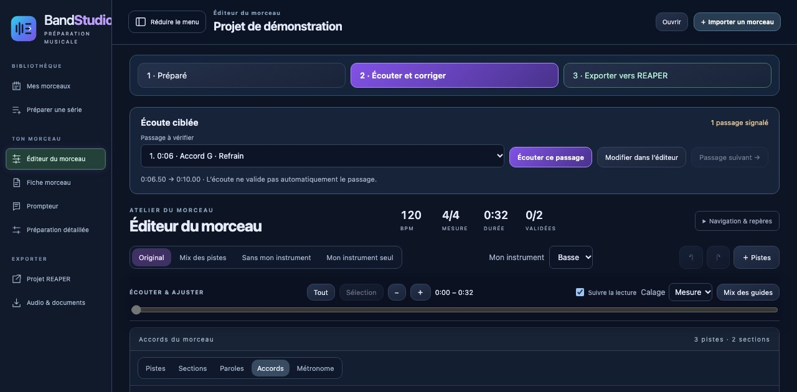
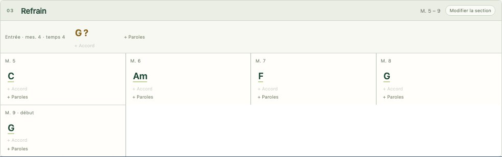

# BandStudio · preparation and editing tutorial

[Français](BANDSTUDIO_TUTORIEL_fr.md) · [Installation guide](BANDSTUDIO.md) · [Website](https://herve8940.github.io/BandStudio/en.html)

Updated 24 November 2026. This tutorial covers the standalone BandStudio app on macOS and Windows. Choose **English** in **Settings → Interface language**, then quit and reopen BandStudio. [From import to REAPER](https://herve8940.github.io/BandStudio/tutorial.html) · [From lyrics to a printable PDF](https://herve8940.github.io/BandStudio/song-sheet.html).

## 1. Import and prepare

Open **My songs** and import an audio file from your computer. Leave **Prepare automatically after import** selected to start preparation when you import a file. For several files, open **Prepare a batch**, add the files, then choose **Start queue** to start the queue.

Open the song in **Song editor** and choose **1 · Prepare**. Installed engines separate instruments and analyse tempo, sections, lyrics and chords. BandStudio generates the click and spoken guides at the end. On Windows, add optional engines in **Settings → Local analysis**. Use **Detailed preparation** to rerun an individual analysis.

The editor opens **Listen and edit** when preparation finishes. Running preparation again reuses completed steps and keeps manual edits. Under **Passage to review**, choose a lyric line, chord, section or beat marker. The editor opens the matching tab. Select **Play this passage** to hear a short excerpt around the marker. BandStudio restores your previous loop afterward. Choose **Edit in song editor** to make a correction, or **Next passage** to listen to the next item.

On import, BandStudio attempts to calibrate the grid before preparing the guides. Timing settings from another song are reset. A status saying “needs review” means you still need to listen, especially to confirm the first downbeat.

## 2. Check the downbeat and count-in

Open **Song editor → Metronome** and check the beginning, a later entrance and the ending. The detected grid follows tempo changes and fills missing pulses. Choose fixed mode to enter a constant tempo. Put the cursor on a downbeat and select **Set beat 1 at the playhead**. Check beats per bar and the count-in. Save changed fields with **Apply to song**. You can then protect the grid from fresh analysis.

The count-in follows the saved grid, including tempo changes. It can overlap the initial silence and accompany a pickup without cutting the song’s audio. Also check a restart in the middle of the song. If an automatic intro has been aligned, listen to its entrance; manually edited or reviewed sections remain protected.

New analyses repair isolated weak or doubled opening detections when a stable rhythm follows. This applies across compatible songs. Listen at the beginning, middle and end: a constant offset suggests checking the first downbeat; growing drift suggests checking tempo or the grid. Avoid imposing a fixed tempo on a recording that varies. Once the grid sounds right, enable **Protect timing from reanalysis**. An update does not overwrite a protected grid.

## 3. Adjust sections and cues

In **Song editor**, choose **Tracks** for mixing or **Sections** for each section’s start, end, length and review status. **Edit** opens a section and **↻** loops it. Use the coloured overview to move to another passage.

Search filters the current view. In Pistes, filter instruments, original audio or guides; **Compact** reduces track height and **Hide inspector** gives the timeline more room. These controls do not change the mix.

To refine a marker:

1. Use **＋**, **−** and **Fit all** to zoom. **Selection** (**F**) fits the selected section; **L** toggles looping and **Alt + ← / →** navigates markers outside text fields. **Scroll through song** moves the visible window; **Follow playback** follows playback.
2. Choose **Bar** or **Beat** snapping, then drag a section boundary or cue. You can also use the **−1 bar**, **+1 bar**, **−1 beat** and **+1 beat** buttons in **One marker at a time**.
3. Click **Listen around marker** to hear the announcement and entrance. Click the marker’s name to edit it.
4. Click **Approve and continue** to review the next marker. The counter shows progress. Moving a marker clears its reviewed status.

A shared boundary keeps adjacent sections continuous. Edits are saved with the song and can be undone or redone.

### Use “Check and complete”

Open **Song editor → Sections** and choose **Check and complete** to compare available sources with your audio and markers. Listen to the proposed changes, then apply them or keep your preparation.

1. Compare **Current / Suggested** and expand **Sources checked** if needed. Unlike the completed Prepare all workflow, this proposal waits for **Apply to project** or explicit validation/export. A chord chart may be available even when timed DRUMY markers cannot be retrieved. An untimed section list does not locate those sections in your recording.
2. Click **Listen to passages** when excerpts are available. Check chords, timing and suggested entrances. “0 passages to review” does not certify the whole song; also listen to the mix, grid and guides.
3. Choose **Keep current arrangement** to keep your preparation. Once the proposal and final listening check are satisfactory, **Review and export to REAPER** applies the proposal and creates the project in one action. Use **Show export** to locate the `.rpp` file.

**No improvements suggested. Current preparation retained** means no change was proposed. The button becomes **Export current preparation to REAPER**. Recalled preparations for the same recording also require approval before export. This assistance does not mark every individual marker as listened to; the classic workflow remains available.

Compatible new SongFormer analyses receive a learned fine timing adjustment: at most 250 ms, with abstention when the learned proposals disagree. It does not rename sections or insert missing transitions. Manual and reviewed sections remain protected. Activation requires verified weights, a 60-second analysis window and a 2–10-minute recording; other configurations keep the original proposals. This corrects section boundaries, not tempo or spoken-cue anticipation. [Evaluation and protocol (FR)](CUE_CORRECTOR_TRAINING.md#résultats-du-lot-réservé-et-distribution).

## 4. Balance the guides

The **Metronome**, **Region announcements**, **Cues** and **Region count-in** tracks have **M** (mute), **S** (solo) and volume controls like the instruments. **Guide mix** groups their settings. Solo respects the other tracks and count-in voices. Changing levels or marking a cue as reviewed does not rerun AI analysis or rebuild guides. Moving a marker may require guide regeneration. Use **Collapse menu** to collapse the left navigation and **Show menu** to restore it.

## 5. Edit the song sheet

[Visual song sheet → PDF tutorial](https://herve8940.github.io/BandStudio/song-sheet.html) · [Visual preparation tutorial](https://herve8940.github.io/BandStudio/tutorial.html)

Choose **Song sheet** (Song sheet) for the open song. When the chorus starts before the next downbeat, look for the **Entry** row at the start of the section. Read the bar and beat in the label. In the example, the chorus starts on beat four of bar 4. The opening chord appears in this row. If your project includes timed lyrics, the sheet also places them on the appropriate beat. Click the **Entry** label to place the playhead at the entrance, then listen.

- Click a chord or lyric line to edit its text and timing. **Details** shows additional position information.
- Use the start/end bar and beat fields, nudge buttons or **Set at playhead**. Moving a lyric line preserves the relative timing of its synchronized words.
- **+ Chord** and **+ Lyrics** add annotations. Replacing chords over a selected interval preserves their portions outside that interval.
- **Import lyrics** uses your own file. **Cancel** and **Redo** undo and redo edits.
- On the sheet, **Compare chord sources** opens the editor’s **Chords** tab. Choose **Open chart** to visit the source. Listen to the same passage to identify a chart that fits your recording. Choose **Use this chart** to apply it. The sheet and teleprompter retain your choice.
- Chords from the chosen source are proposed on the song’s beat grid. Listen and correct their placement; proposals do not guarantee the right arrangement or chord. **Snap to beat / offbeat** helps place a change. Manual edits remain protected.
- Open **Song sheet** (Song sheet) and choose **Correct and realign lyrics**. BandStudio tries the full title, then a simplified title. It can check LRCLIB, lyrics.ovh, Paroles.net, Paroles2Chansons and artist catalogues. The artist helps distinguish songs with the same title. Words are timed against the vocals in your recording. A matching synchronized edition helps locate repeated choruses and account for video intros. Listen to flagged lines. To import your own LRC or SRT file, open **Song editor → Lyrics → Correct or import lyrics**.
- Automatic chord selection prioritizes agreement with your recording. Published song ratings are only a secondary criterion when available; an explicitly selected chart is retained.

If no chart is found, check that the artist is the musician or band, rather than a video uploader, then retry. BandStudio removes labels such as “HD Video” and recognizes several artist/title separators. For partial results, a new search after five minutes retries missing sources while retaining available charts. **Reference unavailable** means that particular source could not be accessed; it does not mean there are no chords anywhere online. Always check that the chart matches your recording’s version.

The sheet edits the open song’s existing annotations. Estimated chords and transcription still need listening checks. A lyric line without word timing remains whole at its starting position.

## 6. Export the PDF and project

Click **Export PDF song sheet**. The printable chart includes sections, bars, chords, lyrics, cues and notes. It follows the saved grid, transposition and capo for displayed chords. Choose a filename and destination for the copy; the PDF then opens in your system viewer. Cancelling the copy keeps the generated PDF in the song’s **Exports** folder. **Show export** helps locate it if automatic opening fails.

When ready, open **3 · Export to REAPER**. Save pending notes and apply your settings. You can record your personal listening check under **My listening checklist (optional)**. Choose **Check and export project** to export, or **Check and open in REAPER** to open it. BandStudio checks the media before export. Keep the **.rpp** file together with its **Audio** folder. Each new export gets its own folder. Check the rights before publicly sharing a sheet containing protected lyrics.

## Update or get help

Use **Check now** in **Settings**. With automatic updates enabled, the verified package is applied after exit. Windows packages and macOS updates are published only after the GitHub checks pass.

On **Windows x64**, extract the entire ZIP before opening `BandStudio.exe`; WebView2 is required. On **macOS Intel or Apple Silicon**, update archives are for prepared installations; new users should follow the [installation guide](BANDSTUDIO.md#macos). After updating, retry chord searches in older projects with missing sources. Manual edits and protected grids are preserved.

Still hearing a timing issue? In **Help & Discord**, describe the passage, tempo and expected behavior. Review the report before posting it in the bug channel. [Join the community](https://discord.gg/5UnQPdMUpR).
