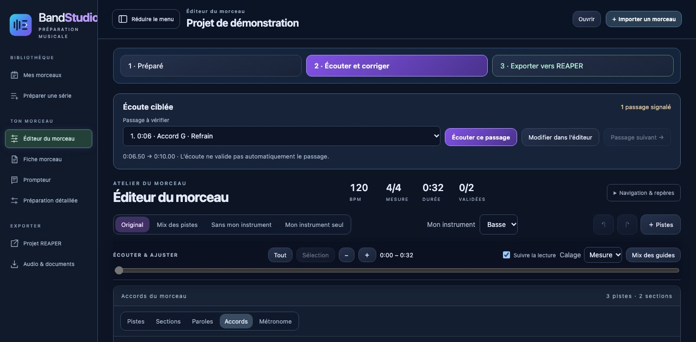
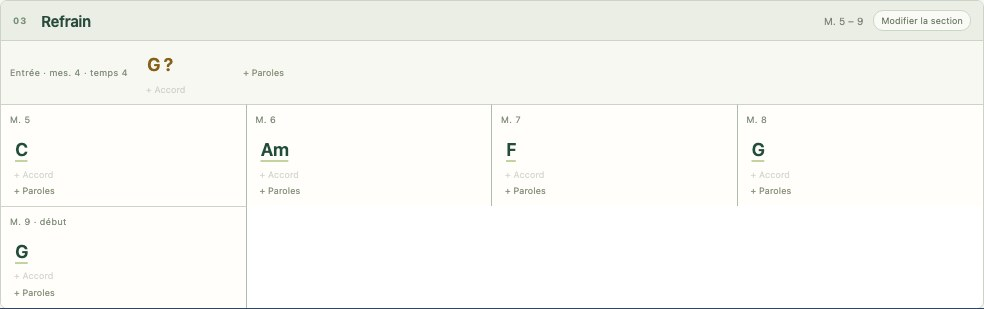

# BandStudio · tutoriel de préparation et de correction

[English](BANDSTUDIO_TUTORIAL_en.md) · [Installation et guide](BANDSTUDIO.md) · [Site](https://herve8940.github.io/BandStudio/)

Mis à jour le 23 novembre 2026. Ce tutoriel concerne l’application autonome BandStudio sur macOS et Windows.

Deux parcours illustrés suivent les commandes de l’application. [De l’import à REAPER](https://herve8940.github.io/BandStudio/tutoriel.html) · [Des paroles à la fiche PDF](https://herve8940.github.io/BandStudio/fiche-morceau.html).

## 1. Importer et préparer

Pour choisir la langue de l’application, ouvre **Réglages → Langue de l’interface**, choisis **Français** ou **English**, puis quitte et rouvre BandStudio.

Dans **Mes morceaux**, importe un fichier audio de ton ordinateur. Laisse **Préparer automatiquement après l’import** coché pour lancer les analyses dès l’import. Pour plusieurs fichiers, ouvre **Préparer une série**, ajoute-les puis choisis **Démarrer la file**.

Ouvre le morceau dans **Éditeur du morceau** puis choisis **1 · Préparer**. Les moteurs installés séparent les instruments et analysent le tempo, les sections, les paroles et les accords. Les guides sont générés à la fin. Pour ajouter un moteur sur Windows, ouvre **Réglages → Analyses locales**. Une analyse particulière peut être relancée dans **Préparation détaillée**.

À la fin, l’éditeur passe à **Écouter et corriger**. Un nouveau lancement réutilise les étapes terminées et conserve tes corrections manuelles. Choisis une ligne de paroles, un accord, une section ou un repère de mesure dans **Passage à vérifier**. L’éditeur ouvre l’onglet correspondant. Clique sur **Écouter ce passage**. BandStudio joue un court extrait autour du repère puis restaure ta boucle précédente. Si une correction est nécessaire, clique sur **Modifier dans l’éditeur**. **Passage suivant** permet de poursuivre l’écoute.

À l’import, BandStudio tente de caler la grille avant de préparer les guides. Les paramètres de calage d’un autre morceau ne sont pas repris. Une indication « à vérifier » signifie que l’écoute reste nécessaire, particulièrement pour le premier « 1 ».

## 2. Vérifier le premier temps et le décompte

Dans **Éditeur du morceau → Métronome**, écoute le départ, une reprise et la fin. Choisis la grille détectée pour suivre les variations du morceau. Elle complète les pulsations manquantes. Le mode fixe permet de saisir un tempo constant. Place le curseur sur un premier temps puis utilise **Placer le « 1 » à la tête de lecture**. Vérifie le nombre de temps par mesure et le décompte. Clique sur **Appliquer au morceau** après avoir modifié les champs. Tu peux ensuite protéger le calage contre une nouvelle analyse.

Le décompte suit la grille enregistrée, y compris ses variations. Il peut commencer pendant le silence initial et accompagner une levée ; l’audio du morceau reste entier. Écoute également une reprise au milieu du morceau. Si une intro automatique a été recalée, vérifie son départ ; les sections corrigées ou validées restent protégées.

Les nouvelles analyses corrigent les détections isolées faibles ou doublées de l’introduction quand la suite confirme un rythme régulier. Cette règle s’applique à tous les morceaux compatibles. Écoute le début, le milieu et la fin : un décalage constant invite à vérifier le premier « 1 » ; une dérive progressive invite à revoir le tempo ou la grille. N’impose pas un tempo fixe à un enregistrement qui varie. Après une correction juste à l’écoute, coche **Protéger le calage contre une nouvelle analyse**. Une grille déjà protégée n’est pas remplacée par une mise à jour.

## 3. Ajuster les sections et les cues

Dans **Éditeur du morceau**, choisis **Pistes** pour le mix ou **Sections** pour les limites, la longueur et la vérification de chaque passage. **Modifier** ouvre la section et **↻** la met en boucle. La vue d’ensemble colorée permet de rejoindre un autre passage.

La recherche filtre la vue courante. Dans Pistes, filtre **Instruments**, **Original** ou **Guides** ; **Compact** réduit la hauteur des pistes et **Masquer l’inspecteur** libère la largeur. **Réduire le menu** replie la colonne de gauche ; **Afficher le menu** la rétablit. Ces commandes ne changent pas le mix.

Pour affiner un repère :

1. Utilise **＋**, **−** et **Tout** pour zoomer. **Sélection** (touche **F**) cadre la section choisie. **L** active la boucle et **Alt + ← / →** parcourt les repères hors des champs de saisie. Le curseur **Parcourir le morceau** déplace la fenêtre visible ; **Suivre la lecture** garde la lecture à l’écran.
2. Choisis le calage **Mesure** ou **Temps**, puis fais glisser une frontière de section ou un cue. Tu peux aussi utiliser **−1 mesure**, **+1 mesure**, **−1 temps** et **+1 temps** dans le panneau **Un repère à la fois**.
3. Clique sur **Écouter autour** pour vérifier l’annonce et l’entrée. Le nom du repère ouvre son édition.
4. Clique sur **Valider et suivant** pour passer au repère suivant. Le compteur indique ce qui reste à écouter. Déplacer un repère annule sa validation.

Une frontière commune conserve la continuité des deux sections. Les corrections sont enregistrées avec le morceau et peuvent être annulées ou rétablies.

### Utiliser « Vérifier et compléter »

Dans **Éditeur du morceau → Sections**, clique sur **Vérifier et compléter** pour comparer les sources disponibles avec l’audio et tes repères. Écoute la proposition puis décide de l’appliquer ou de conserver ta préparation.

1. Compare les frises **Actuelle / Proposée**, lis le récapitulatif et ouvre **Sources consultées** si nécessaire. Contrairement au résultat de **1 · Préparer**, cette proposition attend **Appliquer au projet** ou la validation/export. Une grille d’accords peut être disponible même si les repères minutés de DRUMY n’ont pas été récupérés. Une liste de sections sans horaires n’indique pas où elles commencent dans ton enregistrement.
2. Clique sur **Écouter les passages** lorsqu’il y en a. Vérifie les accords, leurs positions et les entrées proposées. « 0 passages à écouter » ne certifie pas tout le morceau ; écoute aussi le mix, la grille et les guides.
3. Si tu préfères ta préparation, clique sur **Garder le parcours actuel**. Si la proposition convient et que l’écoute finale est faite, **Valider et exporter vers REAPER** applique la proposition et crée le projet en une action. **Afficher l’export** permet de retrouver le fichier `.rpp`.

Le bandeau **Aucune amélioration proposée — préparation actuelle conservée** signifie qu’aucun changement n’a été proposé. Le bouton devient **Exporter la préparation actuelle vers REAPER**. Une préparation retrouvée pour le même enregistrement reste, elle aussi, à confirmer avant export. Cette aide ne marque pas automatiquement chaque repère comme vérifié à l’écoute ; le parcours classique reste disponible.

Les nouvelles analyses SongFormer compatibles bénéficient d’un ajustement fin appris sur des morceaux annotés : déplacement maximal de 250 ms, abstention en cas de désaccord. Il ne renomme pas les sections et ne retrouve pas les transitions manquantes. Il conserve les corrections manuelles et les sections validées. Il s’active uniquement avec les poids vérifiés, une fenêtre d’analyse de 60 secondes et un morceau de 2 à 10 minutes ; les autres analyses conservent leurs propositions initiales. Ce correcteur concerne les frontières de sections, pas le tempo ni l’anticipation des annonces vocales. [Résultats et protocole](CUE_CORRECTOR_TRAINING.md#résultats-du-lot-réservé-et-distribution).

## 4. Doser les guides

Dans **Éditeur du morceau → Pistes**, les pistes **Métronome**, **Appels de régions**, **Cues** et **Décompte des régions** ont leurs commandes **M** (mute), **S** (solo) et volume, comme les instruments. **Mix des guides** rassemble leurs réglages. Le solo tient compte des autres pistes ; il ne laisse pas passer une voix de décompte isolée par erreur. Modifier un volume ou cocher la validation d’un repère ne relance pas une analyse IA ni la fabrication des guides. Modifier le placement d’un repère peut demander leur régénération.

## 5. Corriger la fiche du morceau

**[Suivre le tuto visuel Fiche morceau → PDF](https://herve8940.github.io/BandStudio/fiche-morceau.html)** — 8 étapes pour corriger les accords, les paroles, leur placement et exporter la fiche.

Choisis **Fiche morceau** dans le menu du morceau ouvert. Si le refrain commence avant le prochain « 1 », cherche la ligne **Entrée** en tête de section. Lis le numéro de mesure et le temps indiqués. Dans l’exemple, le refrain démarre au quatrième temps de la mesure 4. L’accord de départ apparaît sur cette ligne. Si ton projet contient des paroles calées, elles suivent également leur position dans la mesure. Clique sur l’indication **Entrée** pour placer le curseur au départ du passage et l’écouter.

- Clique sur un accord ou une ligne de paroles pour modifier le texte et sa position. **Détails** affiche les repères supplémentaires.
- Utilise les champs **Mesure de début**, **Temps**, **Mesure de fin**, **Temps**, les boutons de déplacement ou **Placer au curseur**. Déplacer une ligne conserve les décalages de ses mots synchronisés.
- **+ Accord** et **+ Paroles** ajoutent une annotation. Lorsqu’un accord en remplace d’autres sur une portion, les parties situées en dehors de cette portion restent conservées.
- **Importer des paroles** permet d’utiliser ton fichier. **Annuler** et **Rétablir** permettent de revenir sur les corrections.
- Dans la fiche, **Comparer les sources d’accords** ouvre l’onglet **Accords** de l’éditeur. **Ouvrir la grille** permet de consulter la source. Écoute le passage pour choisir la version qui convient à ton enregistrement. Clique sur **Utiliser cette grille** pour l’appliquer. Le choix est conservé pour la fiche et le prompteur.
- Les accords de la source sont proposés sur la grille rythmique du morceau. Écoute et corrige leur placement ; un calage proposé ne garantit ni la bonne version ni le bon accord. **Caler sur le temps / contretemps** aide au placement. Les corrections manuelles restent conservées.
- Dans **Fiche morceau**, clique sur **Corriger les paroles et recaler**. BandStudio essaie le titre complet puis simplifié. Il peut consulter LRCLIB, lyrics.ovh, Paroles.net et Paroles2Chansons, ainsi que les catalogues d’artistes. Le nom de l’artiste permet de distinguer des titres identiques. Les mots sont calés sur le chant de ton enregistrement. Une version synchronisée compatible aide à distinguer les refrains répétés et les intros de clip. Réécoute les lignes signalées. Pour charger ton propre fichier LRC ou SRT, ouvre **Éditeur du morceau → Paroles → Corriger ou importer les paroles**.
- Le choix automatique des accords privilégie la concordance avec l’enregistrement ; les notes publiques du titre ne sont qu’un critère secondaire lorsqu’elles sont disponibles. Une grille que tu as choisie explicitement est conservée.

Si aucune grille n’est trouvée, vérifie que l’artiste est bien le musicien ou le groupe, pas le nom d’une chaîne vidéo, puis relance la recherche. BandStudio nettoie les mentions telles que « HD Video » et reconnaît plusieurs séparateurs artiste/titre. Pour un résultat partiel, une nouvelle recherche après cinq minutes réessaie les sources manquantes tout en conservant les grilles trouvées. **Référence non récupérée** indique un problème d’accès à cette source, pas l’absence d’accords partout sur Internet. Vérifie toujours qu’il s’agit de la même version du morceau.

La fiche modifie les annotations du morceau ouvert. Les accords estimés et la transcription demandent une vérification à l’écoute ; une ligne sans synchronisation mot par mot reste entière à sa position de départ.

## 6. Exporter une fiche PDF et le projet

Clique sur **Exporter la fiche PDF**. La grille imprimable reprend les sections, les mesures, les accords, les paroles, les cues et les notes. Elle respecte le calage, la transposition et le capo pour les accords affichés. Choisis le nom et l’emplacement de la copie ; le PDF s’ouvre ensuite dans le lecteur de ton système. Si tu annules cette copie, le PDF généré reste dans le dossier **Exports** du morceau. **Afficher l’export** permet de le retrouver si l’ouverture automatique échoue.

Ouvre **3 · Exporter vers REAPER** lorsque le morceau est prêt. Enregistre les notes et applique les réglages en cours. Tu peux consigner ta propre écoute dans **Ma vérification à l’écoute (facultative)**. Choisis **Vérifier et exporter le projet** ou **Vérifier et ouvrir dans REAPER**. BandStudio contrôle les médias avant l’export. Garde le fichier **.rpp** avec son dossier **Audio**. Chaque export crée un nouveau dossier. Vérifie les droits de diffusion avant de publier une fiche qui reproduit des paroles protégées.

## Mettre à jour ou demander de l’aide

Dans **Réglages**, utilise **Vérifier maintenant**. Avec les mises à jour automatiques activées, le paquet vérifié s’applique après fermeture. La distribution Windows et les mises à jour macOS ne sont publiées qu’après réussite des vérifications GitHub.

Sous **Windows x64**, extrais tout le ZIP avant d’ouvrir `BandStudio.exe` ; WebView2 est requis. Sous **macOS Intel ou Apple Silicon**, les archives de mise à jour sont destinées aux installations déjà préparées ; pour un Mac neuf, suis le [guide d’installation](BANDSTUDIO.md#macos). Après la mise à jour, relance la recherche des accords des anciens projets si les sources étaient manquantes. Les corrections manuelles et le calage protégé sont conservés.

Un décalage persiste ? Dans **Aide & Discord**, décris le passage, le tempo et le comportement attendu ; relis le rapport avant de le publier dans le salon des bugs. [Rejoindre la communauté](https://discord.gg/5UnQPdMUpR).
